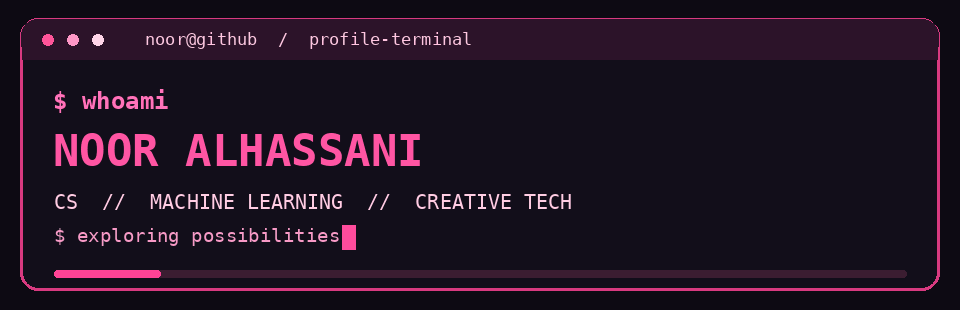

<div align="center">
  
</div>
### software engineering · machine learning · research · creative technology


<br />

[about](#-about-me) · [explore](#-areas-im-exploring) · [projects](#-things-ive-worked-on) · [activity](#-github-activity)

</div>

---

### ♡ about me

> `noor@github:~$ whoami`

I'm **Noor Alhassani**, a Computer Science student interested in the intersection of software, machine learning, research, and design.

I've explored deep learning for energy forecasting, radar-based detection, and user-centered app development.

I enjoy finding out how things work, experimenting with new technologies, and turning ideas into something genuinely useful.

```text
noor@github:~$ cat interests.txt

[01] Software Engineering
[02] Machine Learning & AI
[03] Research & Experimentation
[04] Creative Technology
[05] Human-Centered Design

status: forever curious _
```

---

### ✳ areas i'm exploring

<details>
<summary><b>♡ Machine Learning & AI Research</b> — click to expand</summary>

<br />

Interested in how intelligent systems learn, recognize patterns, and solve real-world problems.

**My experience includes:**
- Deep learning for photovoltaic energy forecasting
- Data analysis and research experimentation
- AI and big data enrichment programs

**Currently interested in:** machine learning, model development, and practical AI applications.

</details>

<details>
<summary><b>✳ Research & Problem-Solving</b> — click to expand</summary>

<br />

I enjoy exploring technical challenges through research and experimentation.

</details>

<details>
<summary><b>⌘ Software Engineering & Product Development</b> — click to expand</summary>

<br />

Interested in the entire process of turning an idea into a working product.

**Experience with:**
- Swift and SwiftUI
- Software architecture and development
- UI/UX and interaction design
- Team-based product development

</details>

<details>
<summary><b>✦ Leadership & Creative Technology</b> — click to expand</summary>

<br />

Technology is only one part of what I love.

I also enjoy creative direction, collaborative projects, and bringing people together to build things.

**Experience includes:**
- Podcast team leadership
- Project coordination
- Creative content development
- Cross-functional teamwork

</details>

---

### ♡ things i've worked on

| Project / Exploration | Area | Description |
|:---|:---|:---|
| **Copirrot** | Wearables · Software | Driver drowsiness detection and smart alerts using Apple Watch and iPhone |
| **yansoon** | SwiftUI · UX | An energy-based task timer designed around sustainable productivity |
| **Solar Energy Forecasting** | Deep Learning · Research | Forecasting rooftop photovoltaic energy production |

*Project links and demos will be added as repositories are published.*

---

### ✳ toolbox

<div align="center">


</div>

<br />

**Currently exploring:** machine learning tools, data workflows, and broader software engineering.

---

### ♡ github activity

<div align="center">


<br />


</div>

---

<div align="center">

`noor@github:~$ exit`

**[ session complete ♡ ]**

*building apps & occasionally overthinking the pixels.*

</div>

